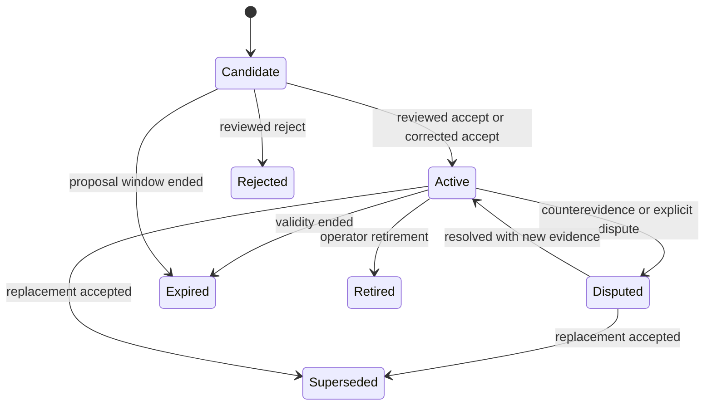

# Plan 004: Add a governed temporal insight ledger

> **Executor instructions**: Read Plans 001 and 002 first. Preserve human veto, exact source provenance, and deterministic compilation. Run each verification command.
>
> **Drift check**: Run `git diff --stat 8ddee39..HEAD -- src/derive.ts src/refinery* src/experience-memory* src/workbench/memory-lab.ts test docs design-specs memory`. Compare the live tracer with this plan. Do not overwrite private review or memory files.

## Status

- **Priority**: P1
- **Effort**: L
- **Risk**: HIGH
- **Depends on**: `plans/002-adapter-conformance-and-loss.md`
- **Category**: direction, migration
- **Planned at**: commit `8ddee39`, 2026-08-03

## Why this matters

Chatlog has strong nomination, adjudication, and publication pieces. Their authority stops at an undocumented manual seam.

The accepted ledger can represent only accepted, correct, current cards. It cannot record disputes, expiry, supersession, counterevidence, or temporal change.

## Current state

- `src/derive.ts:23-49,167-330` emits bounded problems, decisions, gates, attempts, and outcomes.
- `src/refinery.ts:5-58,307-382` emits channel-oriented candidates with recurrence and evidence.
- `src/refinery-judge.ts` fails closed and selects evidence for semantic dispositions.
- `src/refinery-adjudication.ts:39-119,648-782` binds blinded human decisions to source evidence.
- `src/workbench/memory-lab.ts:493-632` writes proposal-bound operator reviews.
- `src/experience-memory-store.ts:141-231` verifies proposal and review bytes before publication.
- `src/experience-memory.ts:36-60` supports only `status: "accepted"`, `judgment: "correct"`, and `freshness: "current"`.
- `src/cli.ts:228-249` publishes a pre-existing accepted ledger. No source-bound assembler creates it.
- Human adjudication confidence, selected evidence, claim kind, and temporal state do not survive the manual seam.

Preserve `autoPromotion: false`. A model, recurrence count, or experiment cannot activate a claim directly.

## Domain model

### Insight kinds

Use a semantic kind. Do not reuse the destination channel as kind.

- fact
- preference
- decision
- episode
- procedure
- hypothesis
- relationship
- current-state

A correction is evidence or a transition. Policy and enforcement are outside the insight ledger.

### Authority

Keep these sources separate:

- source observation
- deterministic derivation
- model proposal
- human assertion
- human review
- measured evaluation
- authoritative document
- assumption

Do not collapse them into one confidence number.

### Lifecycle

Every transition creates a new immutable ledger version. No transition rewrites its evidence history.

## Target storage

Use repository conventions:

- Derived proposal sets remain content-addressed, recipe-bound artifacts under `derived/`.
- Human and governance transitions live in private content-addressed ledger snapshots under `memory/insight-ledgers/`.
- `memory/insight-current.json` points to one ledger hash and one compiled state hash.
- SQLite contains rebuildable read projections only.

A ledger snapshot contains ordered transition events and the previous ledger hash. Old snapshots remain readable.

## Commands

| Purpose | Command | Expected result |
| --- | --- | --- |
| Insight schema tests | `bun test test/insight-ledger.test.ts` | Exit 0 |
| Transition tests | `bun test test/insight-lifecycle.test.ts` | Exit 0 |
| Migration tests | `bun test test/experience-memory-migration.test.ts` | Exit 0 |
| Existing memory tests | `bun test test/refinery.test.ts test/refinery-judge.test.ts test/refinery-adjudication.test.ts test/memory-lab.test.ts test/experience-memory.test.ts test/experience-memory-store.test.ts` | Exit 0 |
| Full gate | `bun run check` | Exit 0 |

## Scope

**In scope**

- Create `src/insights.ts` for types, validation, and state projection.
- Create `src/insight-ledger.ts` for immutable versions and transitions.
- Create `src/insight-compiler.ts` for proposal generation and consolidation proposals.
- Change refinery and judge schemas only to emit semantic claim proposals and complete provenance.
- Change Memory Lab and CLI to support explicit accept, correct, reject, dispute, supersede, expire, and retire commands.
- Change experience-memory compilation to consume active insight projections.
- Create a one-time migration from the current accepted-memory ledger.
- Add SQLite read projections for current insight state.
- Update `design-specs/experience-memory.md`, `docs/knowledge-refinery.md`, `docs/workbench.md`, and `README.md` after behavior passes.

**Out of scope**

- Automatic activation from model output.
- Context delivery or outcome feedback.
- Rewriting external skills, ADRs, or project documentation.
- One global user-psychology profile.
- Hosted inference during Workbench page load.
- Changing enforced policy based on an insight.

## Git workflow

- Use branch `advisor/004-insight-ledger` in an isolated worktree.
- Commit schema, transition engine, migration, and UI changes separately.
- Do not publish or install accepted memories globally without operator authority.

## Steps

### Step 1: Add failing lifecycle and authority tests

Create tests for these cases:

1. A model proposal stays a candidate.
2. A correct operator review without selected genuine evidence cannot activate a claim.
3. Mixed, unjudged, rejected, stale, or malformed sources cannot activate a claim.
4. A human correction can change proposal text before acceptance.
5. Counterevidence moves an active claim to disputed.
6. A replacement supersedes the old claim without deleting history.
7. Validity expiry removes a claim from active context.
8. An explicit global preference differs from an inferred project preference.
9. Two conflicting active revisions cannot compile together.
10. A changed input projection marks dependent proposals stale.

**Verify**: focused tests fail before production implementation.

### Step 2: Define insight and transition schemas

An insight revision must include:

- stable insight ID and immutable revision ID
- semantic kind
- proposition or procedure reference
- scope across user, organization, project, repository, path, harness, model, and tool, plus the conversation domain
- support and counterevidence event references
- observed time and valid-time interval
- system record time
- status
- `supersedes`, `conflictsWith`, and `duplicateOf` relations
- origin and authority records
- derivation activity with recipe, model when used, and input hashes
- separate confidence assessments with assessor and evidence
- authoritative document references and observed hashes

Use the canonical event URI parser for evidence. Reject malformed or inactive event references.

**Verify**: `bun test test/insight-ledger.test.ts` exits 0.

### Step 3: Implement immutable ledger transitions

Define commands and invalid transitions. A command can reference one derived proposal or an existing revision.

Required commands:

- accept
- accept-with-correction
- reject
- dispute
- resolve-dispute
- supersede
- expire
- retire

Each command records the actor, authority, time, reason, source hashes, and prior ledger hash.

Use atomic private writes and mode `0600`. Serialize writers with an explicit lock.

A repeated identical command must be idempotent. A stale prior hash must fail.

**Verify**: transition, concurrency, idempotence, and stale-write tests exit 0.

### Step 4: Build the source-bound acceptance assembler

Connect the existing pipeline without auto-promotion.

The assembler must verify:

- refinery input projection and recipe
- candidate ID and proposal bytes
- judge disposition when present
- selected genuine evidence
- blinded packet mapping
- finalized operator review bytes
- expert decision when required
- semantic kind and scope
- active canonical evidence
- target authoritative channel for procedures or decisions

The assembler produces a proposed ledger command. The operator still invokes the command.

A model-authored confidence value cannot become the sole acceptance confidence. Keep assessor-specific confidence records.

**Verify**: tests prove that wrong packet, stale proposal, mixed verdict, bad evidence pointer, or missing review fails closed.

### Step 5: Add temporal consolidation proposals

The compiler can propose these relations:

- duplicate
- contradiction
- supersession
- expiry
- scope correction

It cannot apply them.

Use deterministic candidate generation first. A model can rank or explain candidates under an explicit receipt, but human authority applies the transition.

Do not resolve contradiction by newest timestamp alone. Show support, counterevidence, scope, and valid time.

**Verify**: fixtures cover changed preferences, temporary decisions, revoked procedures, and unresolved contradictions.

### Step 6: Migrate the current accepted-memory ledger

Read the current v1 ledger and its verified provenance. Produce equivalent active insight revisions and one content-addressed v2 ledger snapshot.

Migration rules:

- Preserve IDs where valid.
- Preserve evidence, proposal, review, and private mapping hashes.
- Preserve legacy `chatlog://conversation/<hash>/turn/<n>` pointers verbatim. The Plan 001 parser accepts both legacy and event-reference grammars.
- Do not rewrite legacy evidence pointers during migration.
- Mark the migration authority and recipe.
- Map current cards to the most accurate semantic kind.
- Do not invent expiry, explicit preference, or broad scope.
- Keep the old ledger readable for rollback.

The migration must be deterministic and dry-run first.

After a successful migration, the v1 ledger is read-only rollback evidence. Remove the v1 publish path and all dual-write behavior.

**Verify**: repeated dry runs produce byte-identical output. The compiled Tier 1 bytes remain equivalent unless a documented schema correction requires change.

### Step 7: Compile only eligible active insights

Change the memory compiler to read the current insight projection.

Eligibility requires:

- active status
- current valid time
- satisfied scope
- active evidence
- accepted authority
- no unresolved higher-priority conflict
- supported delivery risk class

Tier 1 remains a bounded routing index. Tier 2 carries the full card, status, freshness, support, and counterevidence. Tier 3 resolves canonical events.

A retired, expired, disputed, superseded, rejected, or stale revision cannot enter a new snapshot.

**Verify**: existing token-bound, deterministic-order, evidence-exclusion, and session-pinning tests remain green.

### Step 8: Expose operator review without hidden mutation

Update Memory Lab or CLI so each transition is explicit and previewable.

Display:

- proposition and kind
- scope and valid time
- support and counterevidence
- source activity and model receipt
- current status and proposed transition
- changed startup-context effect

Do not add auto-accept, bulk silent accept, or model-triggered publish.

**Verify**: Memory Lab tests prove draft, preview, final command, stale-hash rejection, and no implicit publication.

### Step 9: Bind every stage to freshness

Add content-addressed manifests for judge, proposal, review, ledger, and compiled snapshot stages.

A current pointer must bind:

- input event projection
- derivation and model recipes
- output hash
- ledger hash
- compiled state hash
- project identity

Fix the current read path so it validates the ledger hash, not only the compiled snapshot hash.

**Verify**: changed inputs, stale reviews, altered ledger bytes, and mismatched project identity all fail closed.

### Step 10: Update docs after the full behavior passes

Document the authority table, lifecycle, storage, migration, and rollback.

Remove claims that the v1 accepted ledger is the final lifecycle.

**Verify**: run `bun run check` and `nix flake check --offline`.

## Test plan

Model strict validation after:

- `test/refinery-judge.test.ts`
- `test/refinery-adjudication.test.ts`
- `test/memory-lab.test.ts`
- `test/experience-memory.test.ts`
- `test/experience-memory-store.test.ts`

Every test must assert an observable transition or rejection. Do not test source text or implementation details.

## Done criteria

- [ ] Proposal, review, acceptance, revision, dispute, supersession, expiry, and retirement are representable.
- [ ] Every active insight has source-bound evidence and authority.
- [ ] Confidence remains assessor-specific and evidence-linked.
- [ ] Mixed, unjudged, rejected, disputed, expired, superseded, and stale revisions cannot compile.
- [ ] The v1 accepted ledger migrates deterministically and remains recoverable.
- [ ] The v1 publisher is removed after migration. No code dual-writes v1 and v2 ledgers.
- [ ] Judge, review, ledger, and snapshot stages have freshness manifests.
- [ ] Tier 1 remains below its hard limit and evidence-free.
- [ ] `bun run check` exits 0.
- [ ] `plans/README.md` marks Plan 004 `DONE`.

## STOP conditions

Stop and report if:

- Implementation lets a model activate or retire a claim.
- Existing finalized operator reviews cannot be bound to exact proposal bytes.
- A claim kind or scope requires guessing from prose during migration.
- The ledger duplicates an authoritative skill, ADR, policy, or repository document.
- A lifecycle transition deletes audit history.
- Context compilation cannot distinguish active from disputed or superseded state.

## Maintenance notes

Keep proposals, governance commands, and active projections separate. They have different authority.

A future feedback system can propose transitions. It must use this ledger command boundary instead of editing current memory directly.
