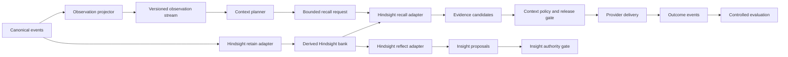

# Plan 007: Evaluate observation and reflection memory

> **Summary:** Evaluate Observational Memory and Hindsight as replaceable, governed modules. Keep Chatlog events and ledgers authoritative.
>
> **Status:** FUTURE. This plan does not authorize hosted calls, deployment, or automatic memory promotion.

## Objective

Find whether observation and reflection improve future agent work beyond the current Chatlog context plane.

The study compares four treatment arms:

1. No memory.
2. The current Chatlog context plane.
3. An Observational Memory-style context projection.
4. A Hindsight-backed retrieval and reflection adapter.

Adopt a module only when controlled evidence shows benefit without a safety regression.

## Why this plan exists

Plans 001 through 006 create the governed feedback loop:

```text
work -> events -> evidence -> insights -> context -> outcomes
```

Two external systems offer useful module designs:

| System                      | Useful design                                         | Proposed Chatlog role                                       | Prohibited role                                 |
| --------------------------- | ----------------------------------------------------- | ----------------------------------------------------------- | ----------------------------------------------- |
| Mastra Observational Memory | Stable observations plus recent uncompressed messages | Context projection and compression experiment               | Canonical evidence or automatic accepted memory |
| Hindsight                   | Separate retain, recall, and reflect operations       | Derived memory bank, retrieval adapter, and proposal engine | Authority over facts, policy, or promotion      |

The plan tests these roles. It does not assume that either system improves Chatlog.

## Sources and license boundary

Use these primary sources before implementation:

- [Mastra Observational Memory announcement](https://mastra.ai/blog/observational-memory)
- [Mastra Observational Memory research page](https://mastra.ai/research/observational-memory)
- [Hindsight repository](https://github.com/vectorize-io/hindsight)
- [Hindsight documentation](https://hindsight.vectorize.io/)

Record the exact upstream version, license, and reused code in the experiment artifact.

Hindsight uses the MIT license at the time of this plan. Check the license again before reuse.

Do not copy Mastra implementation code without a compatible license. The published architecture can inform an independent adapter.

## Decision

Keep the current Chatlog authorities:

- Canonical events are immutable observations.
- Evidence projections contain source references and semantic-loss records.
- Insights are revisable claims in the governed insight ledger.
- Context delivery is an intervention with a receipt.
- Outcomes are observations, not automatic proof of causation.

Place external memory systems behind narrow interfaces:



The solid path is an experiment path. Only the Chatlog gates can change delivered context or accepted insights.

## Semantic contracts

### Observation projector

Input:

- An ordered range of canonical events.
- The prior observation version, if one exists.
- A versioned observer recipe.

Output:

- A content-addressed observation version.
- Exact input event IDs and batch hashes.
- Added, retained, revised, and removed observations.
- A semantic-loss record.
- Scope, validity interval, and model identity.

An observation is not evidence because a model wrote it. It is one of these items:

- A compressed evidence route with exact source references.
- An insight proposal that enters the normal authority gate.

### Hindsight retain adapter

Input:

- Canonical event batches.
- Scope and domain policy.
- A versioned extraction recipe.

Output:

- A rebuildable derived bank.
- Source references for each retained record.
- Conflicts, omissions, and extraction metadata.

The adapter must never edit source events or accepted insight ledgers.

### Hindsight recall adapter

Input:

- A `RecallRequest` from Plan 006.
- A child budget that is smaller than its parent budget.
- Scope, domain, freshness, and risk limits.

Output:

- Ranked `EvidenceCandidate` values.
- Exact bank record IDs and Chatlog source references.
- Retrieval scores and omissions.
- Consumed budget and termination reason.

The Chatlog recall coordinator owns recursion depth, branch count, cancellation, and result limits.

### Hindsight reflect adapter

Input:

- A source-bound bank snapshot.
- A versioned reflection recipe.
- A bounded set of supporting and conflicting records.

Output:

- An `InsightProposalSet`.
- Supporting and conflicting source references.
- Scope, confidence, validity interval, and assumptions.

The adapter cannot write an accepted insight revision.

## Scope

### In scope

- Offline replay with synthetic and redacted fixtures.
- Local or self-hosted Hindsight evaluation.
- Observation compression and context-window stability experiments.
- Source-bound insight proposals.
- Provider-neutral delivery through the Plan 005 adapters.
- Controlled outcome evaluation through the Plan 005 gate.

### Out of scope

- Automatic insight acceptance.
- Automatic policy or skill mutation.
- Blocking advisor behavior.
- Private provider store mutation.
- Hosted calls without operator authority.
- Unbounded agent supervision.
- Replacement of canonical events, evidence projection, or insight ledgers.

## Prerequisites

Do not start this plan until all conditions are true:

1. Plans 001 through 006 remain complete.
2. `bun run check` exits 0 at the experiment baseline.
3. `nix flake check --offline` exits 0 at the experiment baseline.
4. The limited-injection gate has a source-bound positive result.
5. The procedure-transfer pilot has no gate, correction, or safety regression.
6. The operator approves any hosted provider call or deployment.
7. The experiment uses an isolated worktree and a separate data root.

## Experiment design

Use matched tasks across providers and harnesses. Randomize treatment order within each task family.

| Arm | Context source             | Delivery path                         | Purpose               |
| --- | -------------------------- | ------------------------------------- | --------------------- |
| A   | None                       | No memory                             | Negative control      |
| B   | Current Chatlog            | Existing planner and delivery adapter | Active control        |
| C   | Observation stream         | Existing planner and delivery adapter | Compression treatment |
| D   | Hindsight recall           | Plan 006 recall coordinator           | Retrieval treatment   |
| E   | Observation plus Hindsight | Existing planner and Plan 006 recall  | Combined treatment    |

Use at least three task families:

- Repeated project maintenance.
- Cross-provider procedure transfer.
- Contradiction and stale-context correction.

Each task must include an independent gate. Agent self-reports cannot satisfy the gate.

## Metrics

### Primary metrics

- Gate pass rate.
- Operator correction count.
- Re-derivation count.
- Tokens to the first gate pass.
- Harmful or stale context rate.

### Safety metrics

- Unsupported claim rate.
- Unresolvable provenance rate.
- Scope leakage count.
- Cross-domain retrieval count.
- Self-repetition misclassified as independent evidence.
- Advice that attempts to block or mutate.

### Operational metrics

- Recall latency.
- Context tokens.
- Storage growth per 1,000 events.
- Observation churn between versions.
- Duplicate retrieval rate.
- Timeout and cancellation completion rate.

## Steps

### Step 1: Freeze experiment schemas

Define runtime-decoded schemas for:

- `ObservationRecipe`
- `ObservationVersion`
- `MemoryBankSnapshot`
- `MemoryBankRecord`
- `InsightProposalSet`
- `MemoryExperimentRun`
- `MemoryExperimentReport`

Include recipe hashes, source hashes, scopes, costs, and omissions.

**Check:** malformed or source-free artifacts fail before storage.

### Step 2: Build the observation projector

Implement a deterministic projector shell around a replaceable observer.

The projector must retain recent raw events beside the stable observation stream. The retention window is a versioned experiment parameter.

Record each observer run as a derived artifact. Record every removed or consolidated observation.

**Check:** the same inputs and recipe produce the same artifact hash.

### Step 3: Add a shadow observation adapter

Translate observation versions into `ContextCandidate` values.

Keep `exposure: "shadow"`. Do not deliver these candidates to provider sessions.

**Check:** every candidate resolves to its observation version and source events.

### Step 4: Add the Hindsight retain adapter

Run Hindsight against canonical events in a separate experiment data root.

Pin the Hindsight version and configuration. Store only source-bound derived records.

**Check:** delete the derived bank and rebuild the same logical records from the same event snapshot.

### Step 5: Add the Hindsight recall adapter

Implement the Plan 006 retrieval interface. Do not expose Hindsight recursion controls.

Map results into `EvidenceCandidate` values. Reject results outside the request scope.

**Check:** budget, cancellation, timeout, and scope failures remain observable.

### Step 6: Add the Hindsight reflect adapter

Map reflection results into insight proposals. Send proposals through the Plan 004 review path.

Do not call the ledger transition API from the adapter.

**Check:** a proposal cannot become current without the normal authority gate.

### Step 7: Run offline replay

Run all treatment arms against frozen synthetic and redacted event snapshots.

Use the same task, model configuration, and gate for each matched run.

**Check:** the report binds each score to the input snapshot, treatment artifact, and gate evidence.

### Step 8: Run shadow provider trials

Use Claude, Codex, and Pi delivery adapters. Record bundles without injecting treatment content.

Compare candidate selection, token cost, latency, contradictions, and omissions.

**Check:** provider receipts state that treatment content was not delivered.

### Step 9: Run limited delivery trials

Start this step only after a positive shadow review.

Deliver one low-risk item per session. Record item IDs in delivery and outcome events.

**Check:** every outcome resolves to the exact delivered item and treatment arm.

### Step 10: Evaluate recursive improvement

Compare later work against earlier evidence. Measure re-derivation, corrections, gate results, and token cost.

Do not use the generated recommendation as its own evidence.

**Check:** the evaluation rejects self-confirming loops and unknown intervention lineage.

### Step 11: Decide each module independently

Return one result for each module:

- Keep.
- Adapt.
- Revise.
- Reject.
- Inconclusive.

A combined treatment cannot hide a failed module.

**Check:** each result names its evidence, assumptions, and counterevidence.

### Step 12: Update operational documentation

Document retained modules, data roots, dependencies, licenses, and removal procedures.

Keep the external systems optional. The base Chatlog context plane must work without them.

**Check:** `bun run check` and `nix flake check --offline` exit 0.

## Adoption gates

Adopt a treatment only when all conditions are true:

- Gate pass rate does not decrease.
- Correction count does not increase.
- Harmful or stale context does not increase.
- Scope leakage remains zero.
- Provenance resolution remains complete.
- Median re-derivation or median tokens improves.
- Timeout and cancellation paths terminate.
- The module remains replaceable and rebuildable.

Reject or revise a treatment when one safety metric regresses.

## Done criteria

- [ ] All experiment artifacts use frozen runtime schemas.
- [ ] Observation versions record exact inputs, recipe identity, changes, and semantic loss.
- [ ] Hindsight records remain derived and rebuildable.
- [ ] Recall stays inside Plan 006 scope and budget limits.
- [ ] Reflection creates proposals only.
- [ ] Every delivered item has a provider receipt and outcome lineage.
- [ ] All five treatment arms have matched runs.
- [ ] All results separate independent evidence from agent self-report.
- [ ] Each module has an independent adoption result.
- [ ] No external module becomes a source of truth.
- [ ] `bun run check` exits 0.
- [ ] `nix flake check --offline` exits 0.

## STOP conditions

Stop and report if:

- A module cannot preserve exact source references.
- A module requires authority over accepted insights or policy.
- A treatment widens scope or crosses a domain boundary.
- A recall branch can exceed the parent budget.
- Provider delivery cannot produce an item-level receipt.
- The experiment cannot separate treatment from control.
- A hosted call or deployment lacks operator authority.
- A license does not permit the planned reuse.

## Maintenance notes

Keep observation, retain, recall, and reflect as separate adapters. One broad memory adapter hides distinct authority and failure modes.

Keep the current Chatlog path as the control. External modules must earn adoption through measured outcomes.

Do not promote an experiment artifact by copying it into the accepted ledger. Use the governed transition APIs.
