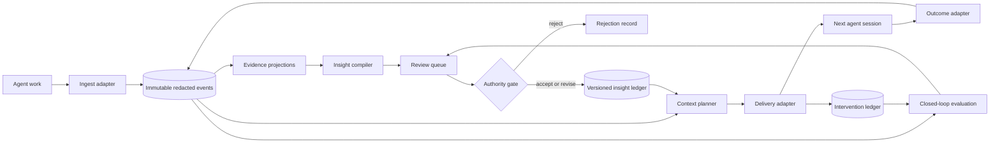
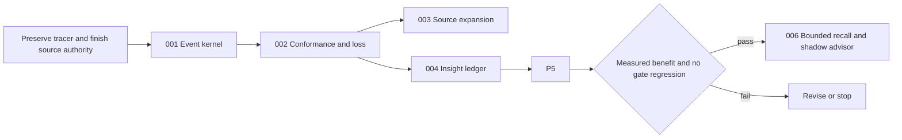

# Provider-Agnostic Context Plane Roadmap

Summary: Evolve Chatlog from a conversation archive into a governed feedback loop. Keep immutable evidence, human authority, bounded recall, and local-first privacy.

This roadmap reconciles the [shared Agent Memory Solutions conversation](https://chatgpt.com/share/6a709867-0878-83eb-8293-fecb3f2362f9) with the live repository at commit `8ddee39` on 2026-08-03.

## Decision

Use one provider-neutral event model at the existing `SourceAdapter.adapt` seam. Keep `Conversation` only as a derived compatibility projection during migration.

Do not add another memory database beside the current pipeline. Deepen the current modules and connect their missing control loop.

“Recursive self-improvement” means this governed cycle:

The evidence plane records observations. The insight ledger records revisable claims. The intervention ledger records what Chatlog caused an agent to see.

The loop does not let a model rewrite its own policy. Evaluation produces a proposal. The authority gate decides the transition.

## Product boundary

| Boundary | Deep module | Small interface | Required receipt |
| --- | --- | --- | --- |
| Provider → context plane | Ingest adapter | `adapt(source) -> EventBatch` | Ingest and semantic-loss receipt |
| Evidence → insight | Insight compiler and ledger | `propose(events, priorState) -> ProposalSet` `apply(command) -> LedgerVersion` | Derivation, review, and transition provenance |
| Context plane → provider | Context planner and delivery adapter | `plan(request) -> ContextBundle` `deliver(bundle, target) -> DeliveryReceipt` | Scope, policy, budget, omissions, and intervention ID |
| Intervention → outcome | Outcome adapter | `observe(session) -> OutcomeEvents` | Session, task, gate, correction, and intervention links |

A provider can support ingestion, delivery, or both. One provider must not require pairwise integration with another provider.

## Canonical vocabulary

| Term | Meaning | Not this |
| --- | --- | --- |
| Source observation | One provider-native item under a declared capture policy | A derived fact |
| Agent event | A normalized statement about observed activity | A transcript summary |
| Evidence | Immutable events plus exact references and provenance | A model conclusion |
| Insight | A revisable claim derived from evidence or a human assertion | Enforcement policy |
| Policy | A rule that controls access, promotion, delivery, or authority | A learned preference |
| Context bundle | A finite, policy-filtered selection for one task and target | The archive |
| Intervention | A context bundle that Chatlog delivered or exposed | A retrieval candidate that was never shown |
| Outcome | An observed result after an intervention | An agent statement that it succeeded |
| Memory | A product projection of active insights and evidence routes | Canonical truth |

Create `CONTEXT.md` from this table during Plan 001. Keep implementation details out of that glossary.

## Reconciliation with the current project

| Shared-conversation insight | Live Chatlog evidence | Roadmap decision |
| --- | --- | --- |
| The event log is canonical. Derived memory is replaceable. | `src/ingest.ts:42-55,116-145` already redacts, hashes, and writes immutable objects. `src/derive.ts:354-416` rebuilds recipe-bound projections. | Keep content addressing and rebuildability. Replace flat adapter output with typed event batches. |
| Normalization must preserve semantic variety. | `src/types.ts:14-45` has flat turns and tool calls. Adapters drop branches, approvals, compaction, artifacts, event IDs, and some tool relations. | Add typed events, explicit relations, source locators, capture policy, and semantic-loss receipts. |
| Evidence, belief, policy, intervention, and outcome are different. | Evidence pointers, refinery candidates, accepted memory, and domain policy already exist. No intervention entity links delivery to later outcomes. | Give each concept its own type and authority. Do not use one generic edge or status. |
| Claims need provenance, revision, and temporal validity. | `src/experience-memory-store.ts:141-231` strongly verifies proposal and operator-review bytes. `AcceptedMemoryEntry` only supports `accepted` and `current`. | Preserve exact provenance. Add proposal, dispute, supersession, expiry, counterevidence, and valid-time transitions. |
| Context injection is an intervention. | The startup hook emits a snapshot, and MCP returns a card. Neither path writes an intervention receipt. | Add the intervention ledger before broad personalization. |
| Recall is a bounded resumable effect. | Current exact card recall is finite. Core retrieval limits are not one shared budget, and no stop reason exists. | Keep cooperative recall first. Add a graded, structured recall runtime only after closed-loop measurement exists. |
| An advisor is an intrusive controller. | Role and orchestration analysis exist, but no live advisor protocol exists. | Keep advisor behavior in shadow mode. Only enforced policy can block. Learned insights remain advisory. |
| Multiple time scales need different authority. | Ingest, derive, refine, operator review, publication, and paired evaluation already run separately. | Formalize immediate, session, consolidation, and governance loops. Do not build one “dreaming” job. |
| Provider-native resume is not portable. | `docs/cross-harness-continuity-findings.md:10-31,101-118` proves this boundary. The Pi bridge is experimental. | Use fresh-session context delivery and pointer-rich handoffs. Never forge native provider stores. |
| Closed-loop utility matters more than recall accuracy. | The 2026-07-28 tracer passed delivery mechanics but did not establish promotion value. | Expand only after shadow and crossover measurements show no gate regression. |

## Theoretical ideas translated into product rules

| Idea from the shared conversation | Product rule | Plans |
| --- | --- | --- |
| MAPE-K | Keep observation, analysis, planning, delivery, and shared knowledge as replaceable modules. | 001, 004, 005 |
| Good Regulator | Store explicit, testable user, project, workflow, and agent-state claims. Do not hide them in embeddings. | 004 |
| Requisite variety | Remove provider syntax differences. Preserve distinctions that change later decisions. Record every loss. | 001, 002 |
| Blackboard architecture | Providers communicate through the context plane. They do not require pairwise integrations. | 001, 003, 005 |
| State estimation | Treat inferred memories as uncertain, temporal, and revisable claims. | 004 |
| W3C PROV concepts | Separate entities, derivation activities, and actors. Keep exact source and recipe hashes. | 001, 004 |
| Second-order cybernetics | Record each context intervention because it changes later observations. | 005 |
| Double-loop learning | Let evidence revise actions easily. Require stronger human authority for goals and policy. | 004, 005 |
| Viable System Model | Apply authority and memory at user, project, repository, path, harness, and organization scopes. | 004, 005 |
| Algebraic effects and structured concurrency | Recall can branch internally, but all branches must terminate and rejoin before one result returns. | 006 |

## Leverage assessment

### Preserve

1. **Immutable evidence and reproducible projections.** These structures make every derived view replaceable.
2. **Human authority and `autoPromotion: false`.** Recurrence and model judgment nominate. They do not become truth.
3. **Progressive disclosure.** Tier 1 routes. Tier 2 explains. Tier 3 resolves canonical evidence.
4. **Local privacy and bounded egress.** Domain allow-lists and explicit receipts are product rules.
5. **Existing seams.** `SourceAdapter`, MCP, refinery routes, and bridge receipts are real extension points.

### Highest-leverage gaps

1. **Stock and flow:** the canonical `Conversation` shape loses provider semantics before evidence exists.
2. **Information flow:** Chatlog does not record which context changed a later session.
3. **Rules:** accepted memory has no complete revision, dispute, expiry, or scope-enforcement lifecycle.
4. **Self-organization:** delivery adapters and bounded recall lack provider-neutral interfaces.

### Inferred paradigm and goal

Chatlog is a local, governed memory compiler. It is not an autonomous profile writer or a universal session converter.

The goal is portable, attributable improvement across agents. The goal is not maximum recall or maximum stored context.

## Approach comparison

| Approach | Benefit | Failure mode | Decision |
| --- | --- | --- | --- |
| Patch `Conversation` and `AcceptedMemoryEntry` | Small initial change | More optional fields cannot represent ordered events, typed relations, or intervention lineage | Reject |
| Replace the whole corpus in one migration | Clean final state | High risk to hashes, evidence URIs, SQLite, derived artifacts, and current product surfaces | Reject |
| Migrate at the adapter seam and project legacy views | One canonical event model with staged downstream cutover | Temporary projection work | **Use this approach** |

The compatibility projection is not a second authority. Adapters stop emitting `Conversation` directly. The projection can remain as a useful read model after migration.

## Execution prerequisites

Do not start Plan 001 until these conditions are true:

1. Preserve or integrate the current dirty experience-memory tracer work. At audit time, the branch had 16 modified and 17 untracked paths.
2. Complete the active-source authority and receipt work in `docs/exec-plans/active/0002-source-lifecycle.md:81-127`.
3. Keep the 2026-07-28 tracer snapshot experimental. Its delivery mechanism passed, but promotion value remained mixed.
4. Use an isolated worktree for each plan. Do not mutate provider source directories or private corpus data.
5. Give delegated workers synthetic fixtures only. The lead performs aggregate real-corpus checks locally.

## Execution order and status

| Plan | Title | Priority | Effort | Depends on | Status |
| --- | --- | --- | --- | --- | --- |
| [001](001-canonical-agent-events.md) | Make agent events the canonical evidence model | P1 | L | Existing source-lifecycle prerequisite | TODO |
| [002](002-adapter-conformance-and-loss.md) | Enforce provider conformance and semantic-loss accounting | P1 | L | 001 | TODO |
| [003](003-expand-provider-sources.md) | Add ChatGPT export and generic event import | P2 | L | 002 | TODO |
| [004](004-governed-insight-ledger.md) | Add a governed temporal insight ledger | P1 | L | 002 | TODO |
| [005](005-context-intervention-loop.md) | Connect context delivery to observed outcomes | P1 | L | 004 | TODO |
| [006](006-bounded-recall-and-advisor.md) | Add bounded recall and shadow supervision | P3 | L | 005 and a positive closed-loop gate | TODO |

Plans 003 and 004 can run in parallel after Plan 002. Plan 005 needs only Plan 004.

## Release stages

| Stage | Agent exposure | Gate |
| --- | --- | --- |
| Offline replay | No live agent context | Event fidelity, loss accounting, and claim calibration |
| Shadow context | Planner records proposed bundles but delivers nothing | Relevance, staleness, scope, and harmful-context review |
| Evidence-only recall | Agents can request canonical evidence | Scope enforcement, budget, and evidence attribution |
| Limited insight injection | Low-risk active claims and procedure pointers | Paired gate, correction, re-derivation, token, and latency results |
| Bounded recursive recall | Multi-branch retrieval joins before one response | Termination, novelty, cancellation, and negative-transfer gates |
| Shadow advisor | Advisor can observe and recommend only | Intervention utility and false-positive rate |

Do not enable an intrusive advisor from this roadmap. That requires a separate operator decision after Plan 006 produces evidence.

## Success measures

### Open-loop quality

- Every accepted source record maps to a normalized event or an explicit semantic-loss entry.
- Equivalent provider sessions answer invariant evidence queries.
- Every insight has support, counterevidence, derivation, review, scope, and temporal status.
- Every derived view rebuilds from active immutable evidence and ledger versions.

### Closed-loop quality

- Every delivered bundle has an intervention receipt.
- Every linked outcome distinguishes observation from agent assertion.
- Evaluation reports task success, gate result, corrections, re-derivation, tool calls, tokens, latency, and cost when available.
- Stability reports stale-memory use, claim churn, oscillation, negative transfer, correction half-life, and self-confirmation.
- A context treatment cannot promote itself from evidence produced only under its own intervention lineage.

## Findings considered and rejected

- **Universal native resume converter:** rejected. Provider stores encode target-owned policy, tools, branches, and model state.
- **Automatic promotion from recurrence:** rejected. The repository already treats frequency as nomination, not truth.
- **Vector database or knowledge graph as the first milestone:** rejected. Storage is not the missing abstraction.
- **One monolithic consolidation job:** rejected. It combines different time scales and authorities.
- **Ambient intrusive recall by default:** rejected. It hides causal context and can create self-confirming behavior.
- **Unredacted provider payloads in the canonical store:** rejected. The current local privacy boundary remains authoritative.

## Repository commands

These commands are the common final gates. Each plan also defines focused commands.

| Purpose | Command | Expected result |
| --- | --- | --- |
| Focused tests | `bun test test/<plan-specific>.test.ts` | Exit 0 and all focused tests pass |
| Type checks | `bun run typecheck` | Exit 0 with no TypeScript errors |
| Repository gate | `bun run check` | Exit 0 with tests, lint, format checks, bundles, and web build complete |
| Nix package gate | `nix flake check --offline` | Exit 0 after inputs exist locally |

## Roadmap review result

This roadmap covers all three requested adapter boundaries and the full feedback loop.

- Provider → context plane: Plans 001, 002, and 003.
- Evidence → insight: Plan 004.
- Context plane → provider: Plans 005 and 006.
- Outcome attribution and recursive improvement: Plans 005 and 006.

The roadmap preserves the current product. It changes the canonical semantics before it expands autonomous behavior.
